# TVM-FFI 核心类型系统详解

> 本文档详细介绍 `3rdparty/tvm-ffi` 模块的核心数据类型和类层次结构。

## 目录

1. [概述](#概述)
2. [C API 层结构体](#c-api-层结构体)
3. [C++ API 层类](#c-api-层类)
4. [类型索引系统](#类型索引系统)
5. [完整类图](#完整类图)
6. [内存布局](#内存布局)
7. [类型特征系统](#类型特征系统)
8. [使用示例](#使用示例)

---

## 概述

TVM-FFI 是一个用于机器学习系统的开源 ABI 和 FFI（Foreign Function Interface）框架。其核心设计围绕两个层次：

- **C API 层** - 稳定的 C 结构体和函数，用于跨语言互操作
- **C++ API 层** - 面向对象的封装，提供类型安全和 RAII 管理

---

## C API 层结构体

### 核心结构体关系图

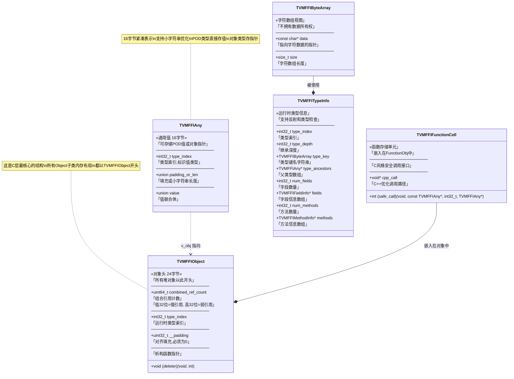

### TVMFFIAny 值联合体详解

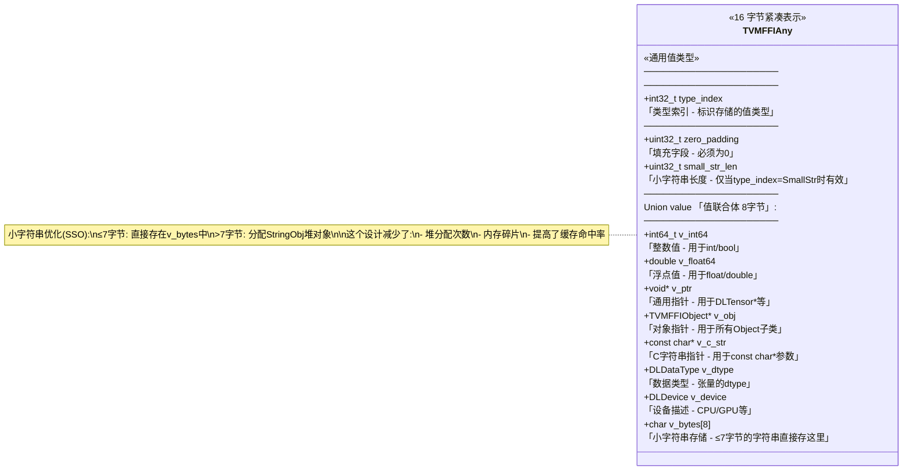

---

## C++ API 层类

### 核心类层次 - Object 继承体系

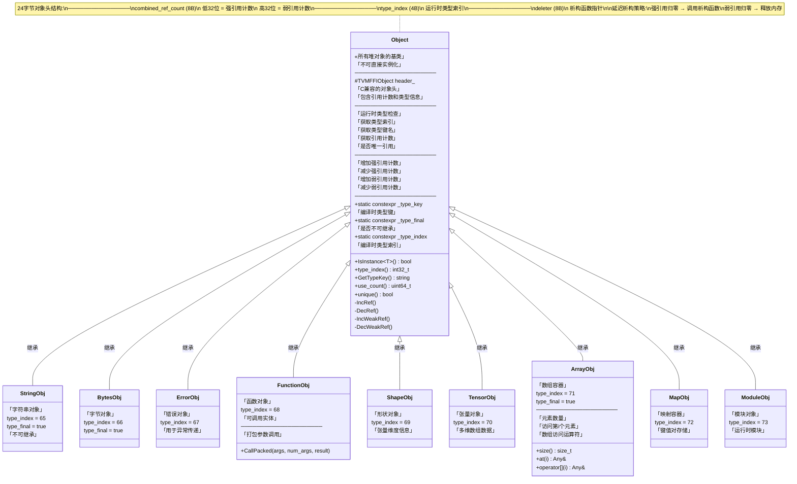

### 引用类型层次

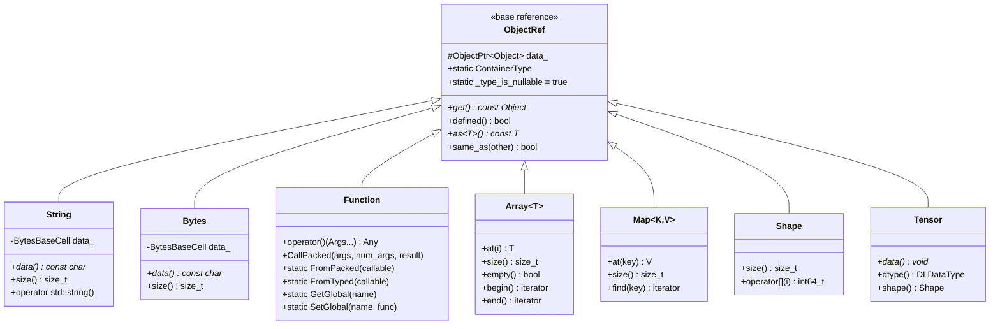

### 智能指针类型

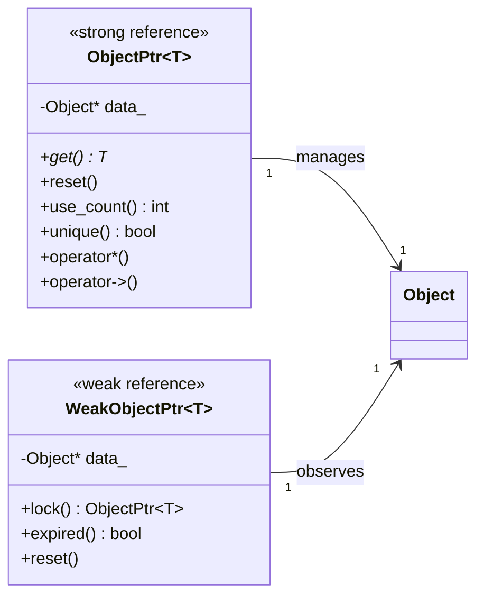

### Any 和 AnyView

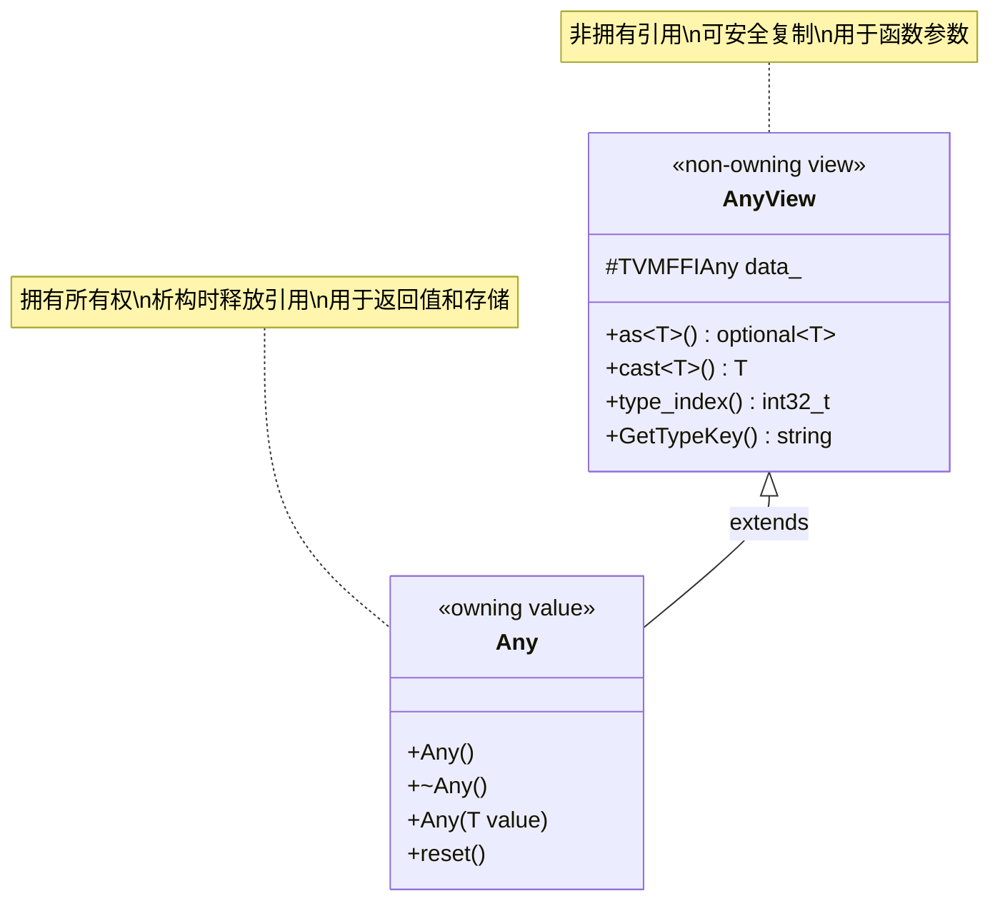

---

## 类型索引系统

### 类型索引分布

```mermaid
graph TB
    subgraph "POD Types [0, 64)"
        N[kTVMFFINone = 0]
        I[kTVMFFIInt = 1]
        B[kTVMFFIBool = 2]
        F[kTVMFFIFloat = 3]
        P[kTVMFFIOpaquePtr = 4]
        DT[kTVMFFIDataType = 5]
        DV[kTVMFFIDevice = 6]
        SS[kTVMFFISmallStr = 11]
        SB[kTVMFFISmallBytes = 12]
    end
    
    subgraph "Static Object Types [64, 128)"
        OBJ[kTVMFFIObject = 64]
        STR[kTVMFFIStr = 65]
        BYT[kTVMFFIBytes = 66]
        ERR[kTVMFFIError = 67]
        FUN[kTVMFFIFunction = 68]
        SHP[kTVMFFIShape = 69]
        TNS[kTVMFFITensor = 70]
        ARR[kTVMFFIArray = 71]
        MAP[kTVMFFIMap = 72]
        MOD[kTVMFFIModule = 73]
    end
    
    subgraph "Dynamic Object Types [128, +∞)"
        DYN[kTVMFFIDynObjectBegin = 128]
        USR[User-defined types...]
    end
    
    N --> I --> B --> F --> P --> DT --> DV --> SS --> SB
    OBJ --> STR --> BYT --> ERR --> FUN --> SHP --> TNS --> ARR --> MAP --> MOD
    DYN --> USR
```

---

## 完整类图

### 完整类型系统概览

```mermaid
flowchart TB
    subgraph "C API Layer"
        CO[TVMFFIObject]
        CA[TVMFFIAny]
        CBA[TVMFFIByteArray]
        CFC[TVMFFIFunctionCell]
        CTI[TVMFFITypeInfo]
    end
    
    subgraph "C++ Core Classes"
        OBJ[Object]
        OREF[ObjectRef]
        OPTR[ObjectPtr T]
        WOPTR[WeakObjectPtr T]
        ANY[Any]
        ANYV[AnyView]
    end
    
    subgraph "Concrete Object Types"
        SO[StringObj]
        BO[BytesObj]
        FO[FunctionObj]
        EO[ErrorObj]
        AO[ArrayObj]
        MO[MapObj]
        SHO[ShapeObj]
        TO[TensorObj]
        MDO[ModuleObj]
    end
    
    subgraph "Reference Types"
        S[String]
        B[Bytes]
        FN[Function]
        AR[Array T]
        MP[Map K V]
        SH[Shape]
        TN[Tensor]
    end
    
    CO --> OBJ : header
    CA --> ANYV : data
    ANYV --> ANY : extends
    
    OBJ --> SO
    OBJ --> BO
    OBJ --> FO
    OBJ --> EO
    OBJ --> AO
    OBJ --> MO
    OBJ --> SHO
    OBJ --> TO
    OBJ --> MDO
    
    OREF --> S
    OREF --> B
    OREF --> FN
    OREF --> AR
    OREF --> MP
    OREF --> SH
    OREF --> TN
    
    OPTR --> OREF : contains
    WOPTR --> OBJ : observes
```

### 对象创建和内存管理流程

```mermaid
sequenceDiagram
    participant User
    participant make_object
    participant Allocator
    participant ObjectPtr
    participant Object
    participant TVMFFIObject
    
    User->>make_object: make_object&lt;T&gt;(args...)
    make_object->>Allocator: SimpleObjAllocator
    Allocator->>Allocator: AlignedAlloc(size)
    Allocator->>Object: placement new T(args...)
    Allocator->>TVMFFIObject: Set header fields
    Note over TVMFFIObject: combined_ref_count = 0x100000001<br/>(strong=1, weak=1)
    Allocator->>ObjectPtr: Create from raw pointer
    ObjectPtr-->>User: Return ObjectPtr&lt;T&gt;
    
    User->>ObjectPtr: reset() / destructor
    ObjectPtr->>Object: DecRef()
    Object->>TVMFFIObject: --strong_ref
    alt strong_ref == 0
        Object->>Object: destructor()
        Object->>TVMFFIObject: --weak_ref
        alt weak_ref == 0
            Object->>Allocator: AlignedFree()
        end
    end
```

---

## 内存布局

### TVMFFIObject 内存布局

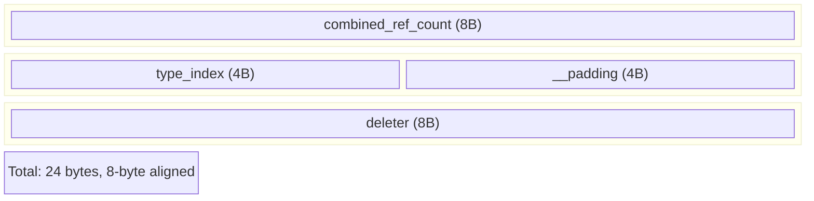

### TVMFFIAny 内存布局

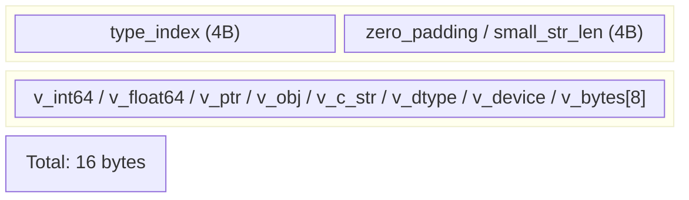

### StringObj 内存布局

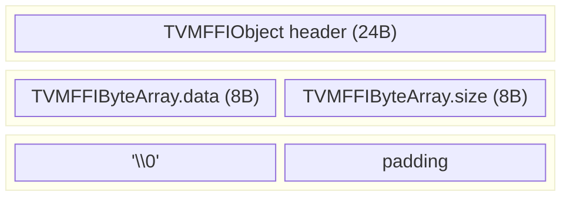

### ArrayObj 内存布局

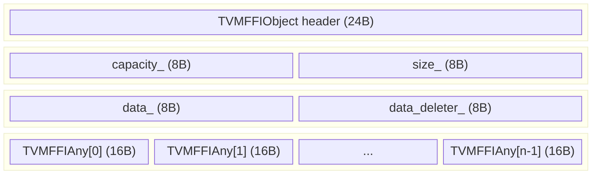

---

## 类型特征系统

### TypeTraits 模板

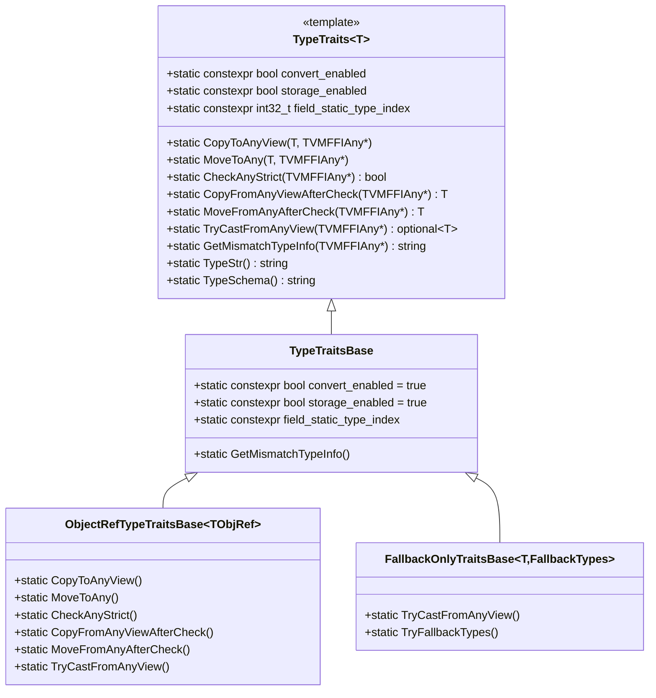

### 类型特化示例

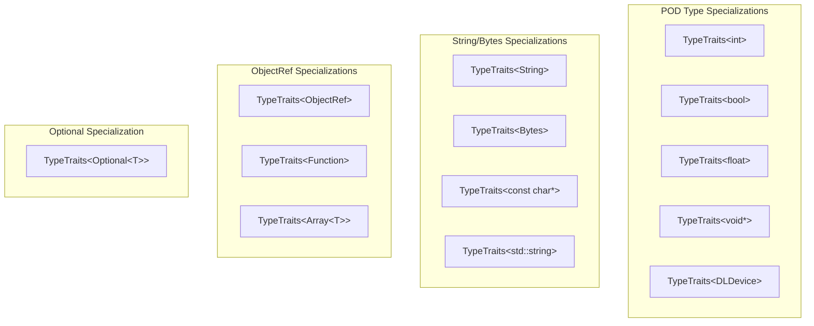

---

## 使用示例

### 创建和使用对象

```cpp
#include <tvm/ffi/memory.h>
#include <tvm/ffi/string.h>
#include <tvm/ffi/container/array.h>

// 创建字符串
tvm::ffi::String str = "Hello, TVM-FFI!";

// 创建数组
tvm::ffi::Array<tvm::ffi::Any> arr = {1, 2.0, "three"};

// 使用 Any
tvm::ffi::Any value = 42;
int64_t int_val = value.cast<int64_t>();

// 使用 Optional
tvm::ffi::Optional<tvm::ffi::String> opt_str = tvm::ffi::String("optional");
```

### 创建函数

```cpp
#include <tvm/ffi/function.h>

// 从 lambda 创建函数
auto add = [](int a, int b) -> int { return a + b; };
tvm::ffi::Function func = tvm::ffi::Function::FromTyped(add, "add");

// 注册全局函数
tvm::ffi::Function::SetGlobal("add", func);

// 调用函数
tvm::ffi::Function add_func = tvm::ffi::Function::GetGlobalRequired("add");
tvm::ffi::Any result = add_func(1, 2);
```

### 自定义对象类型

```cpp
#include <tvm/ffi/object.h>

class MyObject : public tvm::ffi::Object {
 public:
  int value;
  
  explicit MyObject(int v) : value(v) {}
  
  static constexpr const char* _type_key = "MyObject";
  static constexpr bool _type_final = true;
  TVM_FFI_DECLARE_OBJECT_INFO_STATIC("MyObject", MyObject, Object);
};

class MyObjectRef : public tvm::ffi::ObjectRef {
 public:
  TVM_FFI_DEFINE_OBJECT_REF_METHODS(MyObjectRef, ObjectRef, MyObject);
};

// 使用
MyObjectRef ref = tvm::ffi::make_object<MyObject>(42);
```

---

## 参考资料

- 源码位置: `3rdparty/tvm-ffi/include/tvm/ffi/`
- 官方文档: https://tvm.apache.org/
- GitHub: https://github.com/apache/tvm-ffi
