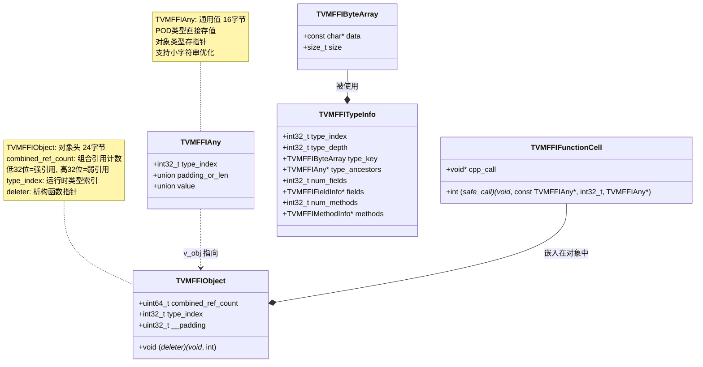
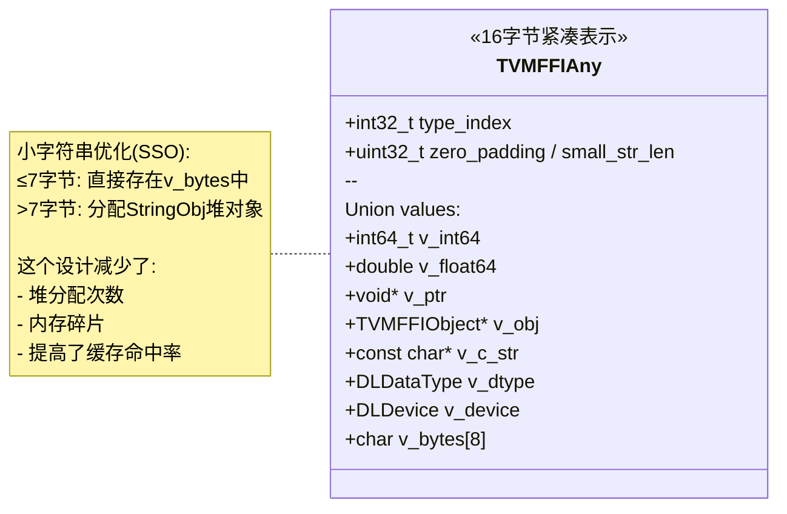
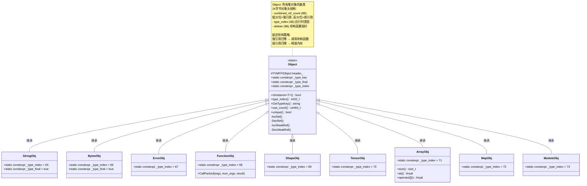
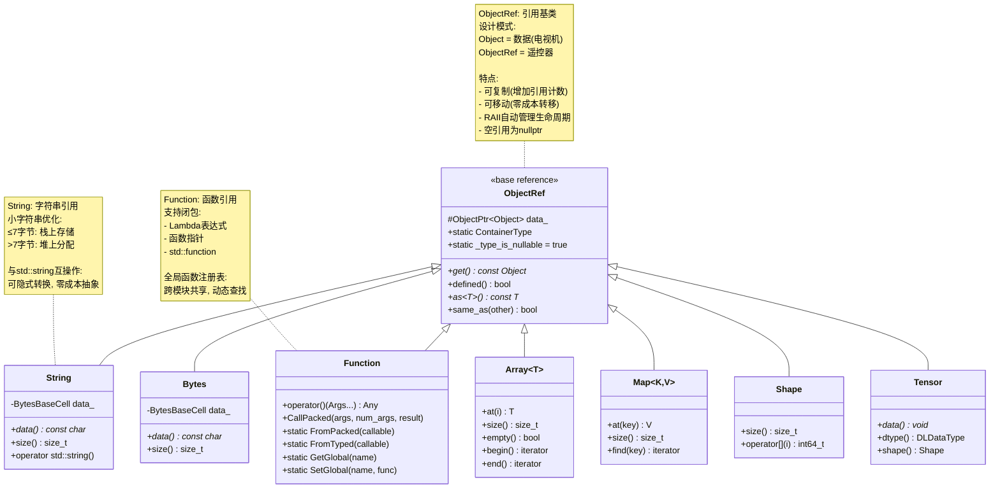
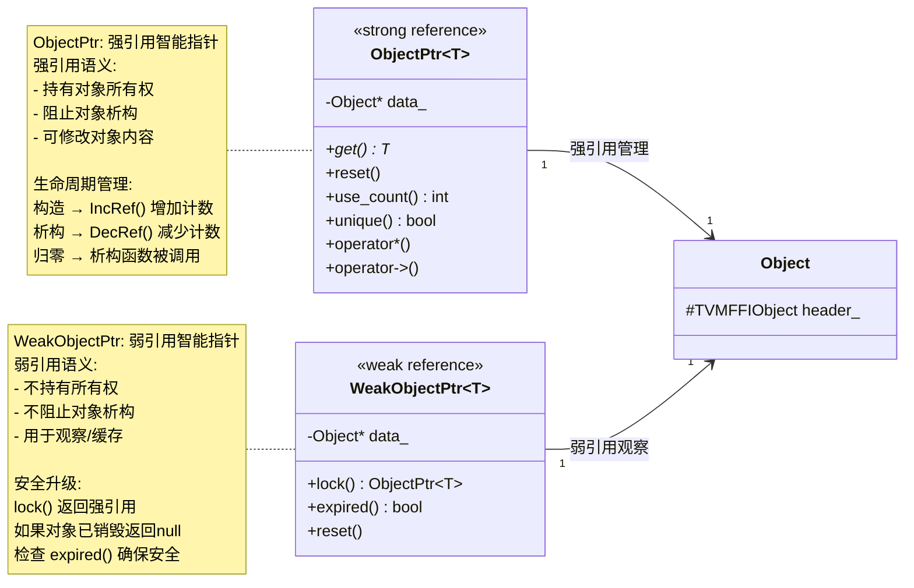
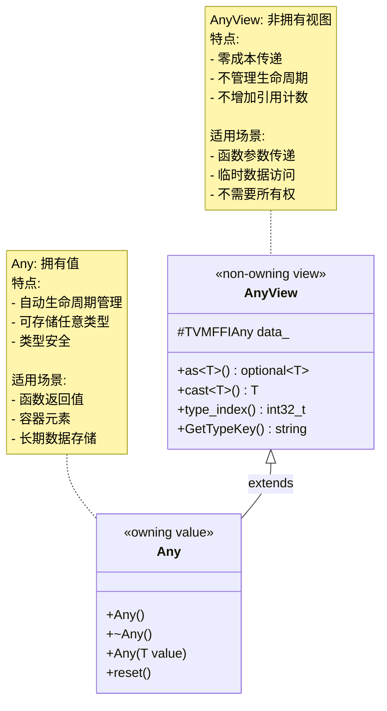
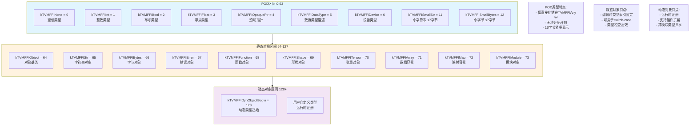
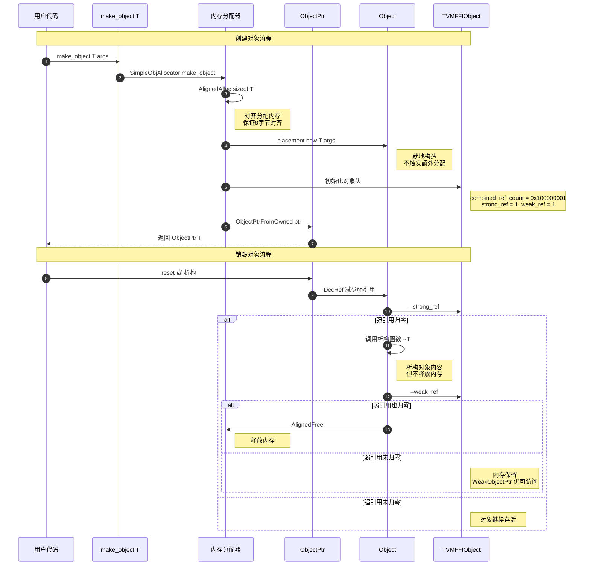

# TVM-FFI 核心类型系统详解

> 本文档详细介绍 `3rdparty/tvm-ffi` 模块的核心数据类型和类层次结构。

## 目录

1. [概述](#概述)
2. [C API 层结构体](#c-api-层结构体)
3. [C++ API 层类](#c-api-层类)
4. [类型索引系统](#类型索引系统)
5. [完整类图](#完整类图)
6. [内存布局](#内存布局)
7. [使用示例](#使用示例)

---

## 概述

TVM-FFI 是一个用于机器学习系统的开源 ABI 和 FFI（Foreign Function Interface）框架。其核心设计围绕两个层次：

- **C API 层** - 稳定的 C 结构体和函数，用于跨语言互操作
- **C++ API 层** - 面向对象的封装，提供类型安全和 RAII 管理

---

## C API 层结构体

### 核心结构体关系图



**结构体说明：**

| 结构体 | 大小 | 用途 |
|--------|------|------|
| `TVMFFIObject` | 24 字节 | 所有堆对象的头部，包含引用计数和类型信息 |
| `TVMFFIAny` | 16 字节 | 通用值类型，可存储 POD 值或对象指针 |
| `TVMFFIByteArray` | 16 字节 | 字符串/字节的视图，不拥有所有权 |
| `TVMFFIFunctionCell` | 16 字节 | 函数对象的核心存储 |
| `TVMFFITypeInfo` | 变长 | 运行时类型反射信息 |

### TVMFFIAny 值联合体详解



---

## C++ API 层类

### 核心类层次 - Object 继承体系



### 引用类型层次 - ObjectRef 体系



### 智能指针类型 - 强引用与弱引用



### Any 和 AnyView - 通用值类型



---

## 类型索引系统

### 类型索引分布 - 运行时类型识别



---

## 完整类图

### 完整类型系统概览 - 架构全景

```mermaid
flowchart TB
    subgraph CLAYER["C API 层 - 跨语言互操作"]
        CO["TVMFFIObject<br/>对象头 24B"]
        CA["TVMFFIAny<br/>通用值 16B"]
        CBA["TVMFFIByteArray<br/>字符数组"]
        CFC["TVMFFIFunctionCell<br/>函数单元"]
        CTI["TVMFFITypeInfo<br/>类型信息"]
    end
    
    subgraph CPPLAYER["C++ 核心类 - 类型安全封装"]
        OBJ["Object<br/>对象基类"]
        OREF["ObjectRef<br/>引用基类"]
        OPTR["ObjectPtr T<br/>强引用指针"]
        WOPTR["WeakObjectPtr T<br/>弱引用指针"]
        ANY["Any<br/>拥有值"]
        ANYV["AnyView<br/>非拥有视图"]
    end
    
    subgraph OBJTYPES["具体对象类型 - 堆分配"]
        SO["StringObj<br/>type=65"]
        BO["BytesObj<br/>type=66"]
        FO["FunctionObj<br/>type=68"]
        EO["ErrorObj<br/>type=67"]
        AO["ArrayObj<br/>type=71"]
        MO["MapObj<br/>type=72"]
        SHO["ShapeObj<br/>type=69"]
        TO["TensorObj<br/>type=70"]
        MDO["ModuleObj<br/>type=73"]
    end
    
    subgraph REFTYPES["用户使用的引用类型 - 值语义"]
        S["String<br/>支持SSO优化"]
        B["Bytes"]
        FN["Function<br/>支持闭包"]
        AR["Array T<br/>编译时类型检查"]
        MP["Map K V"]
        SH["Shape"]
        TN["Tensor"]
    end
    
    CO --> OBJ : header 头部
    CA --> ANYV : data 数据
    ANYV --> ANY : 继承扩展
    
    OBJ --> SO
    OBJ --> BO
    OBJ --> FO
    OBJ --> EO
    OBJ --> AO
    OBJ --> MO
    OBJ --> SHO
    OBJ --> TO
    OBJ --> MDO
    
    OREF --> S
    OREF --> B
    OREF --> FN
    OREF --> AR
    OREF --> MP
    OREF --> SH
    OREF --> TN
    
    OPTR --> OREF : contains 包含
    WOPTR -.-> OBJ : observes 观察
    
    style CLAYER fill:#ffebee
    style CPPLAYER fill:#e8f5e9
    style OBJTYPES fill:#e3f2fd
    style REFTYPES fill:#fff8e1
```

### 对象创建和内存管理流程



---

## 内存布局

### TVMFFIObject 内存布局 (24字节)

```
┌─────────────────────────────────────────────────────────────┐
│           combined_ref_count (8 字节)                       │
│  ┌─────────────────────┬─────────────────────┐              │
│  │   强引用计数 (32位)  │   弱引用计数 (32位)  │              │
│  └─────────────────────┴─────────────────────┘              │
├─────────────────────────────────────────────────────────────┤
│  type_index (4 字节)  │  __padding (4 字节)                 │
│  运行时类型索引        │  对齐填充，必须为0                   │
├─────────────────────────────────────────────────────────────┤
│                    deleter (8 字节)                         │
│                    析构函数指针                              │
└─────────────────────────────────────────────────────────────┘
                    总计: 24 字节, 8 字节对齐
```

### TVMFFIAny 内存布局 (16字节)

```
┌─────────────────────────────────────────────────────────────┐
│  type_index (4 字节)  │  zero_padding / small_str_len (4字节)│
│  类型索引              │  填充或小字符串长度                   │
├─────────────────────────────────────────────────────────────┤
│                    value union (8 字节)                     │
│  ┌───────────────────────────────────────────────────────┐  │
│  │ v_int64     │ 整数值                                   │  │
│  │ v_float64   │ 浮点值                                   │  │
│  │ v_ptr       │ 通用指针                                 │  │
│  │ v_obj       │ 对象指针                                 │  │
│  │ v_c_str     │ C字符串指针                              │  │
│  │ v_dtype     │ 数据类型 (DLDataType)                    │  │
│  │ v_device    │ 设备类型 (DLDevice)                      │  │
│  │ v_bytes[8]  │ 小字符串存储 (≤7字节)                     │  │
│  └───────────────────────────────────────────────────────┘  │
└─────────────────────────────────────────────────────────────┘
                    总计: 16 字节
```

### 小字符串优化 (SSO)

```
┌─────────────────────────────────────────────────────────────┐
│                     小字符串 (≤ 7 字节)                      │
│  ┌───────────────────────────────────────────────────────┐  │
│  │ type_index = 11  │ small_str_len = n  │ v_bytes[0-6]  │  │
│  │     (4B)         │       (4B)         │    字符数据    │  │
│  └───────────────────────────────────────────────────────┘  │
│  ✅ 无堆分配，栈上存储，缓存友好                              │
└─────────────────────────────────────────────────────────────┘

┌─────────────────────────────────────────────────────────────┐
│                     大字符串 (> 7 字节)                      │
│  ┌───────────────────────────────────────────────────────┐  │
│  │ type_index = 65  │ zero_padding = 0  │ v_obj → 堆对象  │  │
│  │     (4B)         │       (4B)       │     (8B指针)    │  │
│  └───────────────────────────────────────────────────────┘  │
│                          ↓                                   │
│  ┌───────────────────────────────────────────────────────┐  │
│  │              StringObj (堆分配)                        │  │
│  │  ┌─────────────────────────────────────────────────┐  │  │
│  │  │ TVMFFIObject header (24B)                       │  │  │
│  │  ├─────────────────────────────────────────────────┤  │  │
│  │  │ TVMFFIByteArray (16B): data指针 + size          │  │  │
│  │  ├─────────────────────────────────────────────────┤  │  │
│  │  │ char data[] (变长) + '\0' + padding             │  │  │
│  │  └─────────────────────────────────────────────────┘  │  │
│  └───────────────────────────────────────────────────────┘  │
└─────────────────────────────────────────────────────────────┘
```

### ArrayObj 内存布局

```
┌─────────────────────────────────────────────────────────────┐
│              TVMFFIObject header (24 字节)                  │
├─────────────────────────────────────────────────────────────┤
│  capacity_ (8 字节)    │  size_ (8 字节)                     │
│  容量                  │  当前大小                            │
├─────────────────────────────────────────────────────────────┤
│  data_ (8 字节)        │  data_deleter_ (8 字节)             │
│  数据指针              │  数据删除器                          │
├─────────────────────────────────────────────────────────────┤
│                    元素数组 (原地分配)                        │
│  ┌─────────────┬─────────────┬─────────────┬─────────────┐  │
│  │ TVMFFIAny[0]│ TVMFFIAny[1]│     ...     │TVMFFIAny[n-1]│ │
│  │   16 字节   │   16 字节   │             │   16 字节    │  │
│  └─────────────┴─────────────┴─────────────┴─────────────┘  │
└─────────────────────────────────────────────────────────────┘
                原地数组: 元素紧跟在对象头部之后
```

---

## 使用示例

### 创建和使用基本类型

```cpp
#include <tvm/ffi/memory.h>
#include <tvm/ffi/string.h>
#include <tvm/ffi/container/array.h>

// ===== 字符串 =====
// 小字符串优化 - 栈上存储
tvm::ffi::String small_str = "hello";  // ≤7字节，无堆分配

// 大字符串 - 堆上存储
tvm::ffi::String large_str = "this is a very long string";  // >7字节

// ===== 数组 =====
// 创建数组
tvm::ffi::Array<tvm::ffi::Any> arr = {1, 2.0, "three"};

// 访问元素
int64_t first = arr[0].cast<int64_t>();
tvm::ffi::String third = arr[2].cast<tvm::ffi::String>();

// ===== Any 类型 =====
// 存储任意值
tvm::ffi::Any value = 42;
int64_t int_val = value.cast<int64_t>();  // 42

// 类型安全转换
if (auto opt = value.as<int64_t>()) {
    std::cout << "int value: " << *opt << std::endl;
}

// ===== Optional 类型 =====
tvm::ffi::Optional<tvm::ffi::String> opt_str;  // 空
opt_str = tvm::ffi::String("hello");           // 有值

if (opt_str.has_value()) {
    std::cout << opt_str.value() << std::endl;
}
```

### 创建和调用函数

```cpp
#include <tvm/ffi/function.h>

// ===== 从 Lambda 创建函数 =====
auto add = [](int a, int b) -> int { 
    return a + b; 
};
tvm::ffi::Function func = tvm::ffi::Function::FromTyped(add, "add");

// ===== 注册全局函数 =====
tvm::ffi::Function::SetGlobal("add", func);

// ===== 调用函数 =====
// 通过全局名称获取
tvm::ffi::Function add_func = tvm::ffi::Function::GetGlobalRequired("add");

// 直接调用
tvm::ffi::Any result = add_func(1, 2);
int sum = result.cast<int>();  // 3

// ===== TypedFunction 类型安全包装 =====
tvm::ffi::TypedFunction<int(int, int)> typed_add = add_func;
int typed_result = typed_add(10, 20);  // 30，编译时类型检查
```

### 自定义对象类型

```cpp
#include <tvm/ffi/object.h>
#include <tvm/ffi/memory.h>

// ===== 1. 定义对象类 =====
class MyObject : public tvm::ffi::Object {
 public:
    int value;
    std::string name;
    
    explicit MyObject(int v, std::string n) 
        : value(v), name(std::move(n)) {}
    
    // 类型信息宏
    static constexpr const char* _type_key = "MyObject";
    static constexpr bool _type_final = true;  // 不可继承
    TVM_FFI_DECLARE_OBJECT_INFO_STATIC("MyObject", MyObject, Object);
};

// ===== 2. 定义引用类 =====
class MyObjectRef : public tvm::ffi::ObjectRef {
 public:
    TVM_FFI_DEFINE_OBJECT_REF_METHODS(MyObjectRef, ObjectRef, MyObject);
    
    // 便捷方法
    int value() const {
        return get()->value;
    }
    
    const std::string& name() const {
        return get()->name;
    }
};

// ===== 3. 使用自定义类型 =====
// 创建对象
MyObjectRef obj = tvm::ffi::make_object<MyObject>(42, "answer");

// 访问成员
std::cout << obj.name() << " = " << obj.value() << std::endl;

// 类型转换
if (auto* ptr = obj.as<MyObject>()) {
    std::cout << "value: " << ptr->value << std::endl;
}

// 存入 Any
tvm::ffi::Any any_obj = obj;
MyObjectRef recovered = any_obj.cast<MyObjectRef>();
```

---

## 设计要点总结

### 核心设计原则

| 原则 | 说明 |
|------|------|
| **C ABI 稳定性** | 所有核心类型都有 C 兼容的内存布局，确保跨语言互操作 |
| **零成本抽象** | Any/AnyView 只有 16 字节，小字符串优化避免堆分配 |
| **类型安全** | 编译时类型检查 + 运行时类型验证，减少运行时错误 |
| **内存效率** | 组合引用计数（一次原子操作管理强/弱引用），原地数组分配 |
| **延迟析构** | 强引用归零时析构对象，弱引用归零时释放内存，支持弱引用观察 |

### 关键技术点

1. **组合引用计数**：`combined_ref_count` 低 32 位为强引用，高 32 位为弱引用
2. **小字符串优化 (SSO)**：≤7 字节的字符串直接存储在 `TVMFFIAny` 中
3. **原地数组**：`ArrayObj` 的元素紧跟在对象头部之后，减少内存碎片
4. **类型擦除**：`Function` 通过 `safe_call` 和 `cpp_call` 支持任意 callable
5. **类型特征**：`TypeTraits<T>` 提供统一的类型转换接口

---

## 参考资料

- 源码位置: `3rdparty/tvm-ffi/include/tvm/ffi/`
- 官方文档: https://tvm.apache.org/
- GitHub: https://github.com/apache/tvm-ffi
